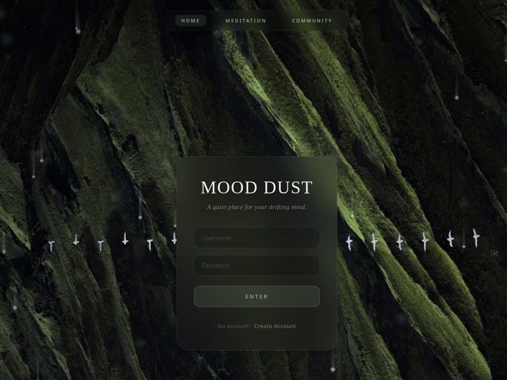

# Mood Dust

> A quiet digital room for the days that feel too loud.

Mood Dust is a reflective web experience for recording moods, shaping private thoughts, slowing down with guided meditation, and sharing small pieces of life with a gentle community.

It is designed to feel less like a productivity dashboard and more like a place you can return to: write a few lines, name what you are feeling, listen to the rain, and leave with a little more room to breathe.

## Live Demo

**GitHub Pages:** [Open Mood Dust](https://lunayyun.github.io/moon-dust/mood_dust.html)



The public Pages version is a browser-first, static edition of the project. It supports local registration and login, diary writing, mood tracking, meditation, local community posts, and other client-side experiences without requiring a Flask server.

## What You Can Do

- **Keep a mood diary** with daily writing, mood selection, images, drafts, and calendar browsing.
- **Generate a softer atmosphere** with rain, ambient sound, visual effects, and typography controls.
- **Practice meditation** with a dedicated space for slowing down and checking in with yourself.
- **Visit the community** to write posts, reply to others, like, favorite, search, and report content.
- **Explore your patterns** through mood history and lightweight personal statistics.
- **Use the private account area** to keep personal resource notes organized.

## Getting Started

### Use the hosted version

No installation is required.

1. Open the [Mood Dust website](https://lunayyun.github.io/moon-dust/mood_dust.html).
2. Create an account on the welcome screen.
3. Sign in and begin with a mood, a sentence, or a quiet moment.

The hosted static version stores account and diary data in your browser's `localStorage`. Your data is available in the same browser and device where it was created.

### Run it locally

The front end can be opened directly in a browser, although a small local server is recommended for a smoother experience with assets and browser security rules.

```bash
git clone https://github.com/Lunayyun/moon-dust.git
cd moon-dust
python3 -m http.server 8000
```

Then open `http://127.0.0.1:8000/mood_dust.html`.

### Optional Flask backend

The repository also contains a Flask + SQLite backend for server-side authentication, diary synchronization, community APIs, account-resource APIs, and the protected AI proxy.

```bash
cp .env.example .env
python3 -m venv .venv
source .venv/bin/activate
pip install flask flask-cors sqlalchemy pyjwt requests
python app.py
```

Before running the backend, set strong values for `SECRET_KEY` and `JWT_SECRET_KEY` in `.env`. Keep that file private.

## What You Need Before Using It

For the hosted version:

- A modern browser such as Safari, Chrome, Firefox, or Edge.
- JavaScript and local storage enabled.
- Enough browser storage for your diary entries and saved images.

For local Flask development:

- Python 3.
- The dependencies listed above.
- A private `.env` file.
- An AI provider key only if you want to use the server-side poetry feature.

## Who Is Mood Dust For?

Mood Dust is for people who want a softer way to notice their inner weather:

- journalers who prefer atmosphere over rigid productivity;
- students and creatives moving through busy or uncertain seasons;
- anyone building a small mindfulness habit;
- people who enjoy reflective writing, mood tracking, and quiet visual spaces;
- developers who want a gentle full-stack project to study and extend.

It is not a medical tool, a crisis service, or a replacement for professional mental-health care.

## Privacy, Storage, and Limitations

The GitHub Pages edition is intentionally self-contained:

- Local accounts are stored only in the current browser.
- Passwords are stored as client-side hashes, but this is **not equivalent to secure server authentication**.
- Data does not automatically move between devices or browsers.
- Clearing browser storage, private browsing data, or site data can remove local accounts and diary entries.
- Static Pages cannot run Flask, SQLite, server-side community synchronization, or protected backend secrets.
- Community posts in static mode are local to the current browser, so they are not a shared public feed.
- Do not store highly sensitive personal information in the static demo.

For real multi-user accounts, shared community data, cross-device synchronization, and production privacy controls, deploy the Flask backend with a persistent database and HTTPS.

## Project Structure

| Path | Purpose |
| --- | --- |
| `mood_dust.html` | Main journal and mood experience |
| `meditation.html` | Meditation space |
| `community.html` | Community interface |
| `account_management.html` | Personal account-resource area |
| `script.js` | Main front-end interactions and local account flow |
| `api.js` | Backend API layer and static-mode fallback |
| `community.js` | Community rendering and interactions |
| `app.py` | Flask application entry point |
| `auth.py` | Backend authentication routes |
| `models.py` | Database models |
| `.env.example` | Safe configuration template |

## Security Notes

Never commit:

- `.env` files;
- API keys, passwords, tokens, or private certificates;
- SQLite database files;
- logs, uploads, virtual environments, or generated Python cache files.

The repository includes a `.gitignore` for these files. If a key has ever been exposed, revoke it in the provider dashboard and create a replacement.

## GitHub Pages Deployment

The repository includes a Pages workflow under `.github/workflows/pages.yml`. Push the project to GitHub, enable **Settings → Pages → GitHub Actions**, and GitHub will publish the static front end.

GitHub Pages is excellent for the visual, local-first edition. It is not a Python hosting platform, so the Flask backend must be deployed separately to a service that supports Python if server-side features are required.

## License

This project is shared for learning, personal reflection, and experimentation. Add a project-specific license before redistributing it as a packaged product.
